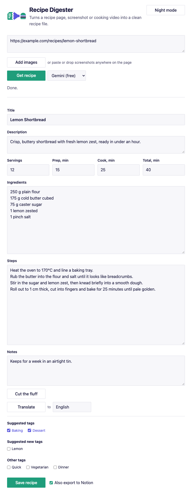

# Recipe Digester

A small app that runs on your own computer. Give it a recipe page, a few screenshots or a cooking video, and it gives you back just the recipe: title, ingredients, steps and notes, without the life story and the adverts. You check it, fix anything you like, and save it as a Markdown file. If you use [Notion](https://www.notion.com), it can add the recipe to a Notion database as well.



## Capabilities

### What you can give it

- **A direct link to a recipe page.** Most recipe sites include the recipe in a machine-readable form, which the app reads directly. For other pages, an AI model reads the page text.
- **Screenshots or photos.** Add one or more images of the same recipe, from a cookbook page, a social media post or a screenshot of a site. You can also paste them or drag them onto the page. Large images are shrunk automatically.
- **A YouTube link.** With Gemini, the model watches the video itself. A video with several recipes gives you each one separately.

### Languages

English and Russian are supported for now. A recipe is kept in the language it was written in, and its summary and suggested tags are written in that language too. The Translate button turns a recipe into the other language, or into any language you type, keeping every number and quantity exactly as it was. You can switch back to the original at any time.

### What it does with the recipe

- **Cut the fluff.** Removes chatter and filler from the steps and notes. It only ever deletes text, never rewrites it, and it doesn't touch the ingredients.
- **Tags.** Suggests tags you've already used, plus a few new ones you can tick. Tags are translated along with the recipe.
- **Duplicates.** Warns you if a recipe with the same title and link is already saved.
- **Saving.** Each recipe becomes a Markdown file in a folder you choose, and can also go to Notion.

## What you need

- Python 3.10 or newer
- One of these:
  - **A free Gemini API key.** This is the default and costs nothing. See [Getting a Gemini key](#getting-a-gemini-key) below.
  - **A Claude subscription that includes [Claude Code](https://claude.com/claude-code).** See [Using Claude instead](#optional-using-claude-instead) below.

## Setup

### Getting a Gemini key

1. If you don't have a Google account, [create one](https://accounts.google.com/signup).
2. Open [Google AI Studio's API keys page](https://aistudio.google.com/apikey), sign in and choose **Create API key**. No payment details are needed for the free tier.
3. Copy the key. You'll paste it into `.env` in the next step. Keep it to yourself, like a password.

Google's own guide, [Using Gemini API keys](https://ai.google.dev/gemini-api/docs/api-key), covers this in more detail. The free tier's limits are listed under [Rate limits](https://ai.google.dev/gemini-api/docs/rate-limits).

### Installing the app

```sh
git clone https://github.com/<you>/recipe-digester.git
cd recipe-digester
python3 -m venv .venv
source .venv/bin/activate        # Windows: .venv\Scripts\activate
pip install -r requirements.txt
cp .env.example .env             # Windows: copy .env.example .env
```

Open `.env` and paste your Gemini key after `GEMINI_API_KEY=`. If you'll only use Claude, leave it empty. Then start the app:

```sh
python app.py
```

and open <http://127.0.0.1:5002> in your browser.

Recipes are saved to the `recipes` folder inside the project. To keep them somewhere else, such as an Obsidian vault, set `RECIPES_DIR` in `.env`.

### Optional: using Claude instead

The app has no sign-in of its own. It uses [Claude Code](https://claude.com/claude-code), Anthropic's command-line tool, logged in to your own Claude account on the same computer. When Claude Code is missing, picking a Claude model shows "Claude is only supported with Claude Code".

1. Check that your plan includes Claude Code: see [Plans & pricing](https://claude.com/pricing) and [Using Claude Code with your plan](https://support.claude.com/en/articles/11145838-using-claude-code-with-your-pro-or-max-plan). The free plan doesn't include it.
2. Install Claude Code. On macOS and Linux:

   ```sh
   curl -fsSL https://claude.ai/install.sh | bash
   ```

   For Windows and other options, follow Anthropic's [Claude Code quickstart](https://code.claude.com/docs/en/quickstart).
3. Run `claude` once in a terminal and log in with your Claude account when it asks. You can close it afterwards; it stays logged in.
4. Restart the app and choose **Claude Sonnet** or **Claude Opus** next to **Get recipe**. To make Claude the default, set `DEFAULT_MODEL=sonnet` in `.env`.

Usage counts against your plan's normal limits, so there's no separate bill. The app deliberately ignores any Anthropic API key set on your computer, so it can't run up API charges by accident. With Claude, YouTube recipes come from the video's transcript, which YouTube sometimes blocks for a while; see [Good to know](#good-to-know).

### Optional: Notion

You need a [Notion](https://www.notion.com) account; the free plan is enough. The app connects through a Notion *integration*, a private key that can only see the pages you share with it.

1. Create an internal integration at [notion.so/profile/integrations](https://www.notion.so/profile/integrations) and copy its secret into `.env` as `NOTION_TOKEN`. Notion's guide: [Create integrations with the Notion API](https://www.notion.com/help/create-integrations-with-the-notion-api).
2. In Notion, open the page where the recipe database should live, choose ••• → Connections, and add your integration. Notion's guide: [Add and manage connections](https://www.notion.com/help/add-and-manage-connections-with-the-api).
3. Run `python setup_notion.py <link to that page>`. It creates a Recipes database there and prints a `NOTION_DATABASE_ID=` line for your `.env`.
4. Restart the app. An "Also export to Notion" checkbox appears next to Save.

If you already have a database, put its link in `NOTION_DATABASE_ID` and run `python setup_notion.py` with no link to check that it has the right properties: Name, Link, Tags, Ingredients and Description.

### Optional: a Dock icon on macOS

Run `./make_app.sh`. It builds `Recipe Digester.app` in the project folder. Drag it to Applications or the Dock. Clicking it starts the app in the background, if it isn't running already, and opens it in your browser. Server messages go to `server.log`.

## The recipe files

Each recipe is a plain Markdown file with a short header, which note apps such as Obsidian show as properties:

```markdown
---
title: "Classic Beef Stew"
source: "https://example.com/classic-beef-stew"
tags: ["Dinner", "Stew"]
servings: "6"
total_min: 150
language: "en"
added: "2026-11-12"
---

# Classic Beef Stew

A rich stew of beef, bacon and red wine.

Serves 6 · Total 150 min

## Ingredients

- 6 oz thick sliced bacon
- 2 - 2 1/2 lbs boneless beef chuck
...
```

## Good to know

- **Free Gemini has limits.** When Google's servers are busy or you hit the free limit, the app tries the next Gemini model on its own. If they're all busy, wait a minute and try again. Long videos use up the free allowance fastest.
- **Your data on the free tier.** Google may use what you send on the free tier to improve its products. Recipes are rarely private, but keep it in mind. See the [Gemini API terms](https://ai.google.dev/gemini-api/terms).
- **YouTube with Claude** works from the video's transcript instead. YouTube sometimes blocks transcript requests for a while; Gemini isn't affected.
- **Some sites block apps.** If a page can't be read, take a screenshot of the recipe instead.
- **Personal use.** The app saves recipes for your own cooking. Respect the terms of the sites and videos you use it with.

## Built with

| Library | Used for | License |
|---|---|---|
| [Flask](https://flask.palletsprojects.com/) | the local web server | BSD-3-Clause |
| [python-dotenv](https://github.com/theskumar/python-dotenv) | reading `.env` | BSD-3-Clause |
| [Pillow](https://python-pillow.github.io/) | shrinking large images | MIT-CMU |
| [yt-dlp](https://github.com/yt-dlp/yt-dlp) | YouTube titles and descriptions | Unlicense |
| [youtube-transcript-api](https://github.com/jdepoix/youtube-transcript-api) | YouTube transcripts | MIT |
| [notion-client](https://github.com/ramnes/notion-sdk-py) | Notion export | MIT |

The AI work is done by the [Gemini API](https://ai.google.dev/) or [Claude Code](https://claude.com/claude-code). Each comes with its own terms, which you accept when you get a key or log in.

## License

[MIT](LICENSE)
